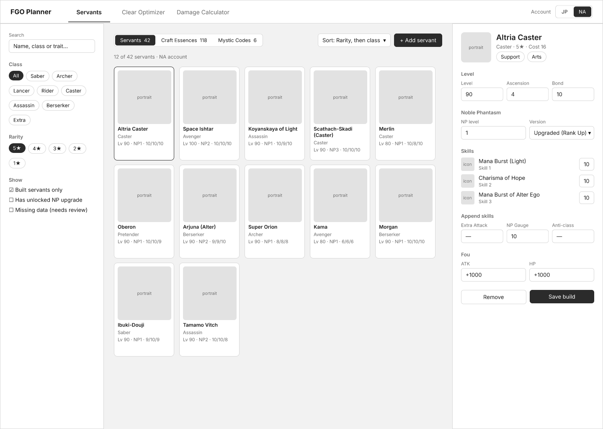
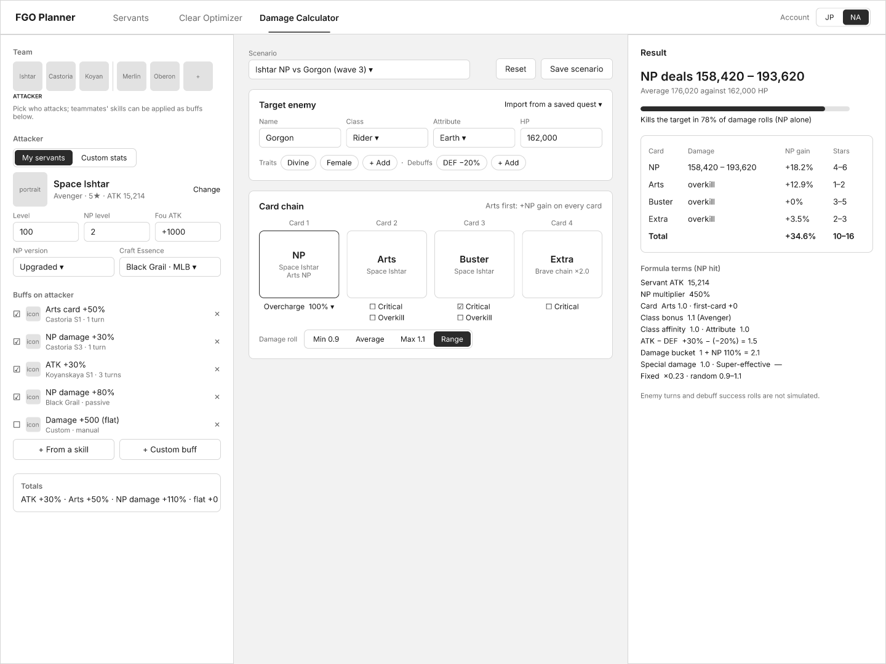
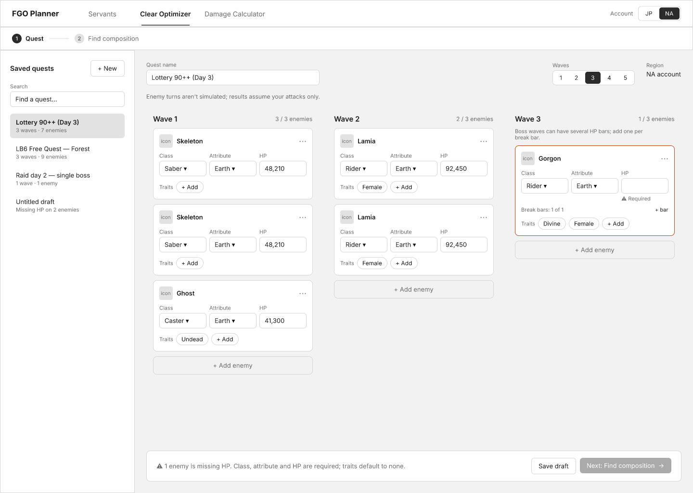
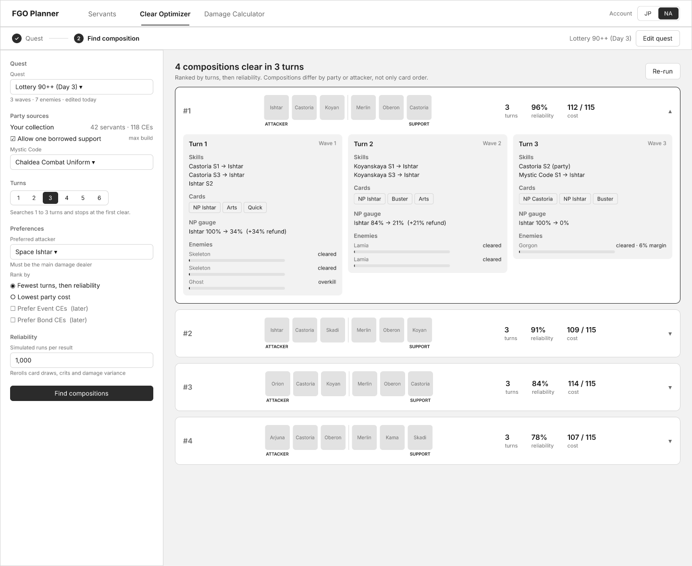

# FGO Damage Calculator

> 🚧 **Work in progress.** A hobby project. The simulation engine is well tested; the web client is being rebuilt and its styling is provisional.

A data-driven damage and NP calculator for *Fate/Grand Order*, growing into a **fastest-clear farming optimizer**. It works from the servants, Craft Essences and levels you actually own, not max-investment numbers, and searches for the fewest turns your account can clear a quest in.

## What it does

- **Damage & NP simulation:** the full damage formula, per-hit NP refund, critical stars, Brave Chains and Extra Attacks, buffs and debuffs, class and attribute affinity.
- **Clear Optimizer:** searches parties, skill timing and card choices for the earliest clear within a turn limit (3 turns is a preset, not a fixed rule). It can include a borrowed support servant.
- **Actionable failure:** when nothing clears, it reports the closest line and the smallest upgrade that would make it clear.
- **Your own roster:** servants, Craft Essences, Mystic Codes and Master level, saved locally per JP/NA account.

Every formula is traced to a primary source. See [`research/`](research/) for the cited mechanics notes behind the engine.

## Design

The web client is being rebuilt to match these wireframes. They are design mockups, not screenshots of the current app.

| Servants | Damage Calculator |
|---|---|
|  |  |

| Clear Optimizer: Quest | Clear Optimizer: Find composition |
|---|---|
|  |  |

## Getting started

Requires Node.js and [pnpm](https://pnpm.io/).

```bash
pnpm install
pnpm run build             # build the engine; the web client imports it
pnpm --dir web run dev     # start the web client
```

Checks:

```bash
pnpm run typecheck
pnpm test                  # fast deterministic suite, no network
pnpm run test:live         # calls the real Atlas Academy API; run sparingly
```

## Project layout

| Path | What's there |
|---|---|
| `src/` | TypeScript engine: formulas, battle state, buffs, quests, optimizer, account and Atlas Academy data adapters. Tests sit next to each module. |
| `web/` | React + Vite client. |
| `research/` | Cited research notes on game mechanics, the spec the engine follows. |
| `design/` | Wireframes and their PNG exports. |

Product scope and design principles are in [`PRODUCT.md`](PRODUCT.md).

## Built with AI agents

I build this with AI coding agents (Claude Code, Codex), working from the spec in [`PRODUCT.md`](PRODUCT.md) and [`research/`](research/). Every behavior change comes with tests.

## Credits & disclaimer

Game data comes from the [Atlas Academy](https://atlasacademy.io/) API. Mechanics research draws on community sources cited in [`research/`](research/).

This is a fan-made, non-commercial tool. It is not affiliated with or endorsed by Aniplex, Lasengle, DELiGHTWORKS or TYPE-MOON. *Fate/Grand Order* and all related names and game data belong to their respective owners.

## License

[MIT](LICENSE) © 2026 Muhammad Alfi Syahrin. The license covers this project's code and documents only, not game data or assets.
